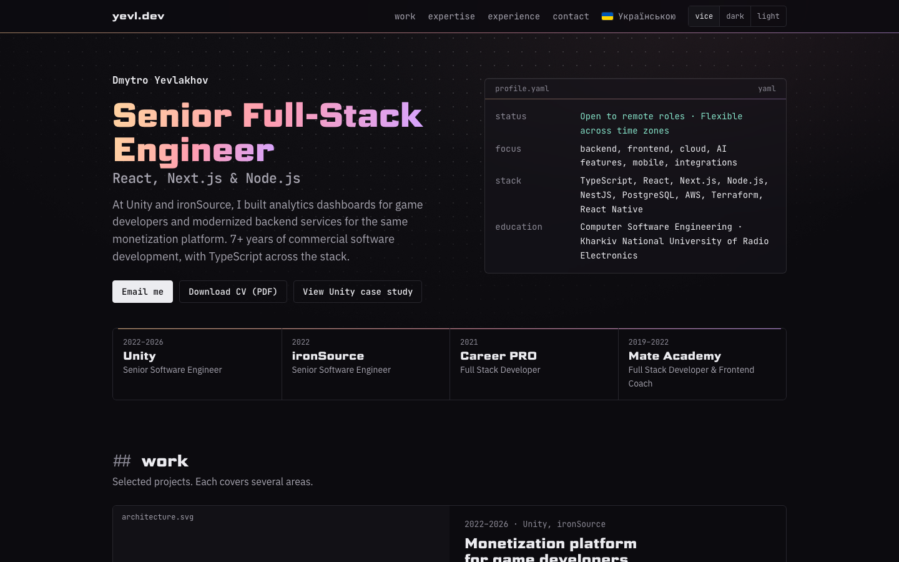

# yevl.dev

Source of [yevl.dev](https://yevl.dev), the personal site of Dmytro Yevlakhov, a senior full-stack engineer (React, Next.js, Node.js, TypeScript). One static page in English and [Ukrainian](https://yevl.dev/uk).

[](https://github.com/dyevlakhov/yevl-dev/actions/workflows/ci.yml)

[](https://yevl.dev)

## What's inside

- **Fully static Next.js 16.** Server components by default, two locales through two root layouts, no i18n library and no middleware.
- **Case studies that work without JavaScript.** Native `<details>` with the full text in the HTML, deep links by hash, smooth expand where the browser supports `::details-content`.
- **A terminal over the page.** Try `help`, `whoami`, `stack` or `theme light`. The interpreter is a pure, unit-tested function, and its output comes from the same typed content as the page.
- **Three themes** (Vice, Dark, Light) on the same DOM, applied before first paint, with contrast checked for every token pair in every theme.
- **CSS-first motion:** scroll-driven animations, View Transitions for the theme change, a few tiny inline scripts, all of it off under `prefers-reduced-motion`.
- **Budgets enforced in CI:** Lighthouse ≥ 95 in every category, LCP < 1.5 s, CLS < 0.05, client JS < 180 KB gzip, WCAG 2.2 AA checked with axe.

How it fits together: [`docs/architecture.md`](docs/architecture.md). Decisions: [`docs/adr/`](docs/adr/).

## Stack

Next.js 16 · React 19 · TypeScript · Tailwind CSS 4 · MDX · Zod · Vitest · Playwright + axe · Lighthouse CI · Vercel

## Run it locally

Requires Node.js 24 and pnpm (the version is pinned in `package.json`).

```bash
pnpm install
pnpm dev            # http://localhost:3000
```

| Command                | What it does                              |
| ---------------------- | ----------------------------------------- |
| `pnpm typecheck`       | TypeScript, no emit                       |
| `pnpm lint`            | ESLint                                    |
| `pnpm format:check`    | Prettier                                  |
| `pnpm test`            | unit tests (Vitest)                       |
| `pnpm build`           | production build                          |
| `pnpm e2e`             | end-to-end and accessibility (Playwright) |
| `pnpm lhci`            | Lighthouse budgets against a local build  |
| `pnpm perf:cold <url>` | cold-cache layout-shift check             |

A few copy-rule tests read private patterns (see `tests/guard-terms.ts`) and are skipped in a fresh clone. Everything else runs as is.

## Layout

```
src/app/          routes: (en)/ and (uk)/uk/, OG images, sitemap, robots, 404
src/components/   landing sections, terminal, diagrams, UI primitives
src/content/      typed content per locale; case studies in MDX
src/design/       colour tokens (source of truth for the CSS variables)
src/lib/          terminal interpreter, theme, JSON-LD, small inline scripts
tests/            unit/ (Vitest), e2e/ (Playwright), perf/
docs/             architecture overview and ADRs
```

## License

The code is under the [MIT License](LICENSE). You're welcome to read it, learn from it and reuse parts of it.

The personal content is not: the text in `src/content/`, the case studies, `public/cv.pdf` and the name and likeness of the author are © Dmytro Yevlakhov, all rights reserved. If you build your own site from this code, replace the content with your own.

Fonts are under the SIL Open Font License 1.1 (see [`src/assets/fonts/`](src/assets/fonts/)).
